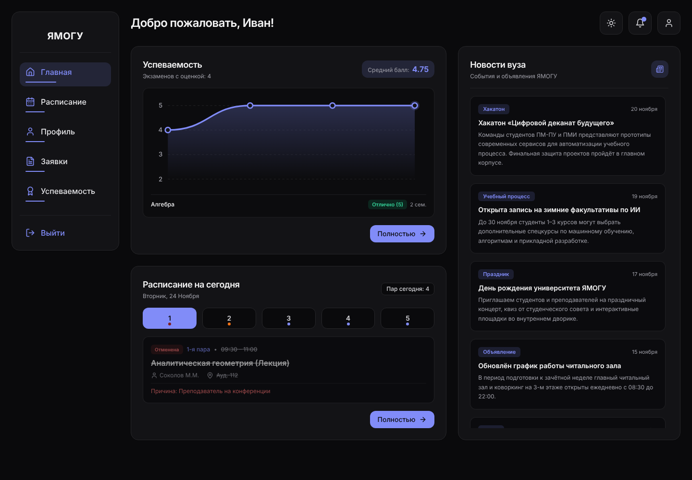
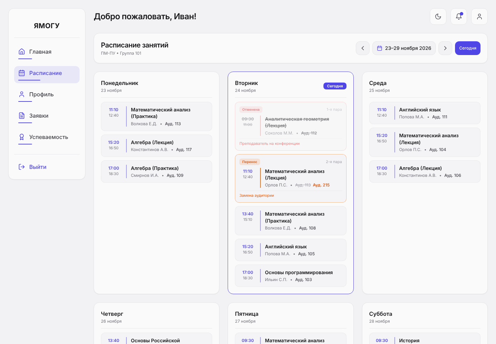
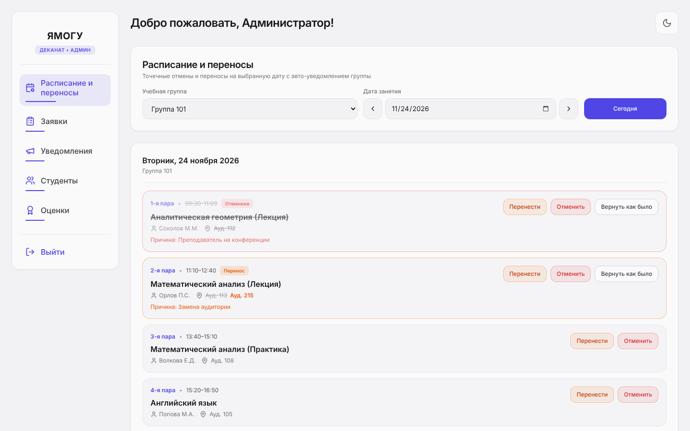
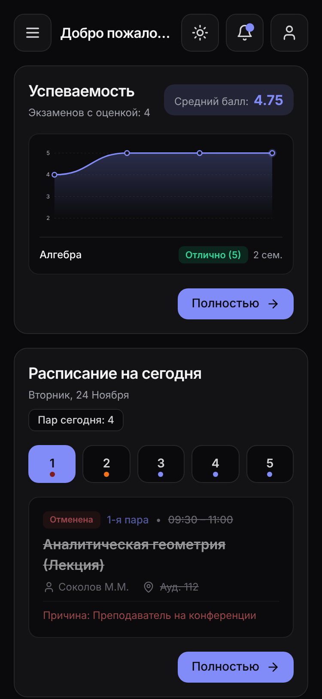

<p align="center">
  
</p>

# ЯМОГУ — Цифровой деканат будущего


Веб-платформа цифрового деканата, разработанная в рамках **MGIMO AI Challenge 2026**. Система объединяет личный кабинет студента и панель управления администратора деканата в одном адаптивном веб-приложении с ролевой изоляцией данных, живым расписанием и мгновенными уведомлениями.

---

## Проблема и решение

Учебные процессы в вузах часто раздроблены между статичными PDF-расписаниями, бумажными заявлениями на справки и разрозненными чатами. Студенты поздно узнают о переносах пар и статусе документов, а сотрудники деканата тратят время на ручное оповещение групп.

**ЯМОГУ** закрывает этот цикл в едином интерфейсе:
* **Единый источник правды по расписанию:** базовое расписание с авточередованием недель дополняется точечными отменами и переносами на конкретные календарные даты и встроенным календарём каникул.
* **Двусторонняя синхронизация в реальном времени:** любое действие администратора (перенос/отмена пары, смена статуса справки, выставление оценки) автоматически обновляет экран студента и создаёт персональное или групповое уведомление.
* **Адаптивный интерфейс (от 360px):** комфортная работа как с ноутбука в деканате, так и со смартфона студента, с сохранением светлой/тёмной темы отдельно для каждого аккаунта.

---

## Возможности системы

### Кабинет студента (6 разделов)
* **Главная (дашборд):**
  * интерактивный SVG-график успеваемости по 5-балльной шкале (плавная кривая Безье, выбор точек, автоматический расчёт среднего балла);
  * компактный виджет расписания на сегодня (кнопки 1–5 пары с цветовыми индикаторами обычных, перенесённых и отменённых занятий);
  * лента новостей и событий университета.
* **Полное расписание:** календарная навигация по неделям, выпадающий календарь выбора даты, автоматический учёт летних, новогодних и зимних каникул, наглядное отображение переносов (зачёркнутое старое время/аудитория + новое значение и причина) и отмен.
* **Успеваемость (электронная зачётка):** переключение между 1-м и 2-м семестрами, сводка по среднему баллу и количеству экзаменов/зачётов.
* **Заявки на справки:** онлайн-заказ справок (об обучении, в военкомат, справка-вызов, характеристика) с отслеживанием статуса и комментариев деканата.
* **Уведомления:** индикатор непрочитанных сообщений, отметка прочтения по клику (включая независимый учёт прочтения массовых объявлений для каждого студента).
* **Профиль:** персональная карточка студента (ФИО, факультет, учебная группа, номер зачётной книжки, логин).

### Кабинет администратора деканата (5 разделов)
* **Расписание и переносы:** выбор группы и конкретной даты, точечная отмена или перенос пары (новая аудитория, новое время, причина), возврат пары к базовому расписанию — с автоматической рассылкой уведомлений всей группе.
* **Обработка заявок:** фильтрация заявок (`Все` / `В обработке` / `Завершённые`), перевод в статус «Готово» или «Отклонено» с комментарием для студента.
* **Рассылка уведомлений:** отправка объявлений всем студентам, конкретной учебной группе или выбранному студенту.
* **Управление студентами:** регистрация новых учётных записей с серверным хэшированием паролей (`bcrypt`) и проверкой уникальности логина и зачётной книжки; адаптивный список (таблица на десктопе, карточки на мобильных).
* **Выставление оценок:** добавление, обновление и удаление экзаменационных оценок и зачётов для любого студента с авто-уведомлением и мгновенным пересчётом графика успеваемости.

---

## Скриншоты интерфейса

| Главная студента (тёмная тема) | Расписание с переносами и отменами |
| :---: | :---: |
|  |  |

| Кабинет администратора | Мобильная версия (375px) |
| :---: | :---: |
|  |  |

---

## Технологический стек и архитектура

| Слой | Технологии |
| :--- | :--- |
| **Backend** | Python 3.10+, FastAPI, Uvicorn, Pydantic v2 |
| **База данных** | SQLite 3 (`PRAGMA foreign_keys = ON`, `ON DELETE CASCADE`) |
| **Безопасность** | JWT (`HS256` через `python-jose`), хэширование паролей `bcrypt` (`passlib`), ролевые зависимости `require_student` и `require_admin` (`403 Forbidden`) |
| **Frontend** | Single-Page Application (`index.html`), Tailwind CSS, Lucide Icons, Vanilla JS |

### Схема базы данных (`dekanat.db`)
* `users` — учётные записи, хэши паролей и роли (`admin`, `student`);
* `student_profiles` — изолированные академические данные студента (`faculty`, `group_name`, `grade_book`);
* `schedule` — базовое расписание по группам и чередующимся неделям (с генерацией без коллизий аудиторий);
* `schedule_changes` — точечные отмены и переносы с ограничением `UNIQUE(schedule_id, change_date)`;
* `grades` — результаты промежуточной аттестации по семестрам;
* `requests` — заявки на справки со статусами и `admin_comment`;
* `notifications` и `notification_reads` — личные и массовые уведомления с персональным трекингом прочтения.

---

## Быстрый запуск (за 3 шага)

### 1. Клонирование и установка зависимостей
```bash
git clone https://github.com/<ваш-логин>/<имя-репозитория>.git
cd <имя-репозитория>

python -m venv venv
# Windows:
venv\Scripts\activate
# macOS / Linux:
source venv/bin/activate

pip install -r requirements.txt
```

### 2. Настройка окружения и инициализация базы данных
При желании скопируйте `.env.example` в `.env` (для локального тестирования это необязательно — используются значения по умолчанию). Относительный `DATABASE_PATH` (например, `dekanat.db`) считается от папки проекта, поэтому приложение находит базу независимо от того, из какой папки его запустили.

Создайте чистую базу данных и заполните её тестовыми данными одной командой:
```bash
python setup_db.py
```

### 3. Запуск сервера
```bash
uvicorn main:app --reload --host 0.0.0.0 --port 8000
```

После запуска откройте в браузере:
* **Веб-приложение:** `http://localhost:8000`
* **Интерактивная документация API (Swagger UI):** `http://localhost:8000/docs`

> **Тестирование с телефона:** фронтенд автоматически определяет адрес сервера по `window.location.origin`, поэтому сайт можно открыть на смартфоне в той же Wi-Fi сети по адресу `http://<локальный-IP-компьютера>:8000`.

---

## Деплой на PythonAnywhere

Приложение запускается на PythonAnywhere как ASGI-сайт через `uvicorn`. Все шаги автоматизирует скрипт `deploy_pythonanywhere.py`.

1. На PythonAnywhere откройте **Account → API token** и нажмите **Create** (один раз). Если на домене уже висит старое WSGI-приложение, удалите его на вкладке **Web**.
2. В консоли Bash склонируйте репозиторий и запустите скрипт:
   ```bash
   git clone https://github.com/<ваш-логин>/<имя-репозитория>.git
   cd <имя-репозитория>
   python3.13 deploy_pythonanywhere.py
   ```
   Скрипт создаёт `venv`, ставит зависимости, генерирует `.env` со случайным `SECRET_KEY`, инициализирует базу (если нет `dekanat.db`) и запускает сайт командой `pa website create`.
3. Откройте `https://<логин>.pythonanywhere.com` (первые секунды возможен 404 — обновите страницу).

Полезные параметры: `--domain`, `--eu` (аккаунт на EU-сервере), `--python python3.12`, `--dry-run` (показать команды, ничего не выполняя).
Обновление после изменений в коде: `git pull && python3.13 deploy_pythonanywhere.py` (сайт перезагрузится).
Логи: `/var/log/<логин>.pythonanywhere.com.error.log`.

### Если что-то не работает

| Симптом | Причина и решение |
| :--- | :--- |
| Сайт долго грузится, в access-логе код `499` | Приложение завёрнуто в WSGI (`a2wsgi`) и зависает под uWSGI. Используйте ASGI-запуск из этого раздела (`uvicorn` через `pa website create`) |
| «Неверный логин или пароль» при правильных данных, в error-логе `no such table: users` | Сайт открыл пустую базу не из той папки. Проверьте, что `DATABASE_PATH` в `.env` указывает на `dekanat.db` из папки проекта (или просто `dekanat.db` — путь считается от папки проекта), затем `pa website reload --domain <логин>.pythonanywhere.com`. Пустой лишний `~/dekanat.db` можно удалить |
| 404 сразу после `pa website create` | Первые секунды после создания это нормально — обновите страницу |
| Команда `pa` не найдена | Вызовите её полным путём: `~/.pa-cli/bin/pa ...` |
| Ошибка при создании сайта | Создайте API token (**Account → API token**) и удалите старое WSGI-приложение на вкладке **Web** |

> ⚠️ Сгенерируйте собственный `SECRET_KEY` (скрипт делает это сам) и не публикуйте файл `.env` — он добавлен в `.gitignore`.

---

## Тестовые аккаунты для жюри

| Роль | Логин | Пароль | Описание |
| :--- | :--- | :--- | :--- |
| **Администратор** | `admin_jury` | `admin2026` | Полный доступ к панели деканата (`/api/admin/...`) |
| **Студент (ПМ-ПУ)** | `stud_pmpu` | `stud1234` | Иванов Иван Иванович — Группа 101 (`PMPU-26-001`) |
| **Студент (ПМИ)** | `stud_pmi` | `stud5678` | Смирнова Анна Алексеевна — Группа 202 (`PMI-26-042`) |

### Быстрый сценарий проверки для жюри
1. Войдите под `stud_pmpu / stud1234`, изучите график успеваемости, календарное расписание (включая каникулы в январе/июле) и закажите любую справку в разделе **«Заявки»**.
2. Выйдите и войдите под `admin_jury / admin2026`:
   * переведите заявку студента в статус **«Готово»** с комментарием;
   * отмените или перенесите одну пару для **Группы 101** на ближайший учебный день;
   * выставите новую экзаменационную оценку студенту в разделе **«Оценки»**.
3. Снова войдите под `stud_pmpu / stud1234` — в расписании отобразится перенос/отмена, график успеваемости обновится, а на колокольчике появятся автоматические уведомления.

---

## Основные эндпоинты API

| Группа | Метод и путь | Назначение |
| :--- | :--- | :--- |
| **Auth** | `POST /api/login`, `GET /api/me` | Авторизация по OAuth2/JWT и профиль текущей сессии |
| **Студент** | `GET /api/profile` | Карточка текущего студента (изоляция по `user_id` из JWT) |
| **Студент** | `GET /api/schedule?start_date=...&end_date=...` | Календарное расписание с каникулами и точечными правками |
| **Студент** | `GET /api/grades` | Электронная зачётная книжка студента |
| **Студент** | `GET /api/requests`, `POST /api/requests` | История и создание заявок на справки |
| **Студент** | `GET /api/notifications`, `PATCH /api/notifications/{id}/read` | Получение уведомлений и отметка прочтения |
| **Админ** | `GET /api/admin/groups`, `GET /api/admin/schedule` | Список групп и расписание группы на конкретную дату |
| **Админ** | `POST /api/admin/schedule/changes`, `DELETE /api/admin/schedule/changes/{id}` | Отмена, перенос и восстановление пары с авто-уведомлением |
| **Админ** | `GET /api/admin/requests`, `PATCH /api/admin/requests/{id}` | Просмотр и обработка заявок студентов |
| **Админ** | `POST /api/admin/notifications` | Рассылка объявлений всем, группе или студенту |
| **Админ** | `GET /api/admin/students`, `POST /api/admin/students` | Просмотр и регистрация студентов |
| **Админ** | `GET /api/admin/grades`, `POST /api/admin/grades`, `DELETE /api/admin/grades/{id}` | Выставление, обновление и удаление оценок |

---

## Структура репозитория

```text
yamogu-digital-dean/
├── main.py                    # FastAPI бэкенд, JWT-авторизация, ролевые эндпоинты
├── index.html                 # Адаптивный SPA-фронтенд (Tailwind CSS + Vanilla JS)
├── deploy_pythonanywhere.py   # Автодеплой на PythonAnywhere одной командой
├── setup_db.py                # Единая инициализация чистой БД одной командой
├── requirements.txt           # Зависимости Python
├── .env.example               # Шаблон переменных окружения
├── .gitignore                 # Исключение локальной БД, venv, кэша и секретов
├── LICENSE                    # Лицензия MIT
├── README.md                  # Документация проекта
├── scripts/
│   ├── init_db.py             # Создание базовых таблиц и тестовых аккаунтов
│   ├── generate_schedule.py   # Генерация неконфликтующего расписания на 2 типа недель
│   ├── seed_data.py           # Наполнение оценками, заявками и уведомлениями
│   ├── migrate_admin.py       # Создание таблиц schedule_changes и notification_reads
│   └── check_db.py            # Утилита диагностики структуры и содержимого БД
├── static/
│   ├── logo.png               # Логотип университета ЯМОГУ
│   └── news/
│       ├── hac.avif           # Обложка новости о хакатоне
│       └── birth.jpg          # Обложка новости о дне рождения университета
└── docs/
    └── screenshots/           # Скриншоты интерфейса для README
```

---

## Команда

Проект создан для **MGIMO AI Challenge 2026**:

* **Мохов Евгений**
* **Ярослав Яблонский**